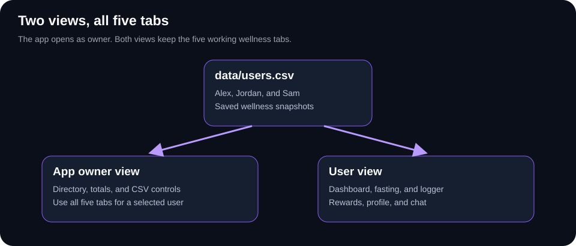
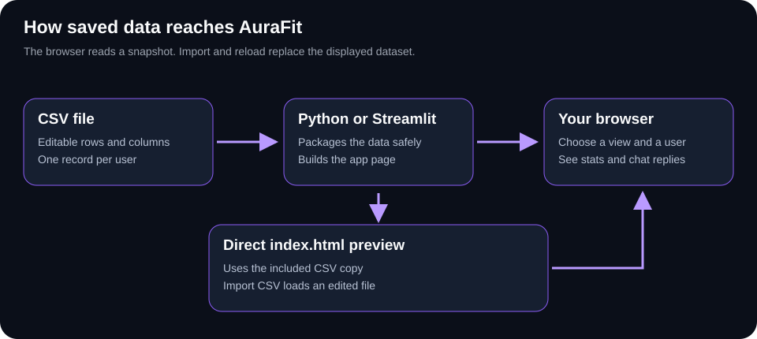

# AuraFit User Guide

This guide explains how to run AuraFit after downloading the repository
and how to use its dashboard. No coding experience is needed. The HTML
copy has a clickable contents list and diagrams; the Markdown copy displays
with formatting on GitHub.

## 1. What AuraFit Does

AuraFit displays saved wellness information for three fictional users:
Alex Morgan, Jordan Lee, and Sam Rivera. You can see fasting progress,
water intake, movement, meals, and progress points. A small chat companion
can explain the selected person's statistics and offer motivation.

The app opens in App owner view. A top-right menu switches to User view.
Neither mode requires a login. CSV records provide the starting statistics;
the five tabs let you start timers, log habits, claim virtual rewards, and
change settings. New progress is saved separately for each user in this
browser. The app does not collect data from phones or fitness devices.

## 2. Download And Open The Project Folder

On the repository's GitHub page, choose Code, then Download ZIP. Extract
the ZIP and open the extracted project folder. Keep the files and folders
together. You should see streamlit_app.py, requirements.txt, index.html,
and the components, utils, and data folders.

For the full Streamlit experience, install Python 3.12 on your computer.
On Windows, select the option to add Python to PATH during installation.
Open a terminal inside the extracted folder: on Windows, right-click in
the folder and choose Open in Terminal. On other systems, open a terminal
and navigate to that folder.

## 3. Run The App In Streamlit

### Windows

Run these commands one at a time in the project folder:

    python -m venv .venv
    .\.venv\Scripts\python.exe -m pip install -r requirements.txt
    .\.venv\Scripts\python.exe -m streamlit run streamlit_app.py

The first command creates a separate place for the app's Python packages.
The second installs them; it needs an internet connection. The third starts
the app. You do not need to activate the environment separately.

### macOS or Linux

    python3 -m venv .venv
    .venv/bin/python -m pip install -r requirements.txt
    .venv/bin/python -m streamlit run streamlit_app.py

Open http://localhost:8501 in your browser. Keep the terminal running while
you use the app. Press Ctrl+C in that terminal when you want to stop it.
The app runs on your own computer; these steps do not publish it online.

### Later runs

Once setup is complete, only run the final Streamlit command for your system.
You do not need to create the environment or reinstall the packages each time.

### Without Python

Double-click index.html to preview the app directly in your browser. This
uses the sample data included inside the page and does not need installation.
Use Import CSV to load an edited dataset. The Streamlit document sidebar
is available only when running through Streamlit.

## 4. Explore The Dashboard

### Read the dashboard

Available XP means progress points currently available. Lifetime XP means
all points earned. Completed fasts counts finished sessions. Streak shows
recorded consecutive days with completed fasts. Hydration is measured in
milliliters, movement in minutes, and food energy in kcal.

The owner dashboard includes the saved CSV fasting snapshot and chart.
The User Dashboard shows the current live timer and your completed-session
chart. Running timers are highlighted in red. CSV records are dated October
12, 2026; an old recorded active status does not automatically start a timer.

### Theme menu

Choose one of six themes in the top-right menu: Obsidian Violet, Midnight
Ocean, Forest Emerald, Velvet Rose, Golden Hour, or Daylight. The colors of
the dashboard and chat change together. Your browser remembers the theme.

In Streamlit, scroll inside the app panel to reach more dashboard content.
If the bottom of the panel is below your screen, scroll the main Streamlit
page until the chat is visible, then continue scrolling inside the app.
Use the sidebar to open the project guide or development history.

## 5. Switch Between The Two Views

### App owner view

The default Dashboard shows the user directory and combined statistics. Choose
a person in View user data, or select their View data button. The dashboard
then shows only that person's stats. Choose All users to return to the
directory. The owner Dashboard also has CSV management buttons. The other
four tabs let the owner work with the selected person's profile.

### User view

Choose User view from the top-right view menu. Its five tabs focus on one
person's wellness progress and hide the owner directory and CSV management
buttons. The user selector lets you try each sample profile. All five tabs
remain visible in both views.

### Choosing a person

If you switch to User view while a person is selected, that profile stays
selected. If none was selected, the first sample profile opens. Switching
back restores the previous owner selection. The chat remains available.
These are preview modes, not protected accounts or login permissions.

## 6. Use The CSV Data

CSV is a simple spreadsheet-like text file. The supplied dataset lives in
data/users.csv, with one row per person. Keep its column names unchanged.
You can edit values in a text editor or spreadsheet program and save as
UTF-8 CSV. The README lists the columns and allowed values.

### Reload CSV

In Streamlit, use Refresh source CSV in the sidebar after editing the file.
This recreates the app panel, so its selection and chat reset. Browser-saved
sessions, logs, reward claims, and settings are restored for each user. The Reload
CSV button inside the panel explains this sidebar action.

### Import CSV

In App owner view, choose Import CSV and select a file on your computer.
The imported data is shown for the current page session. It does not replace
the file on disk. Import also works in a direct index.html preview.

### Download CSV

Download CSV saves a copy of the source dataset loaded in the app panel,
including imported data. It contains all rows even if one profile is selected.
It does not export new browser progress; use Export progress in Profile for
that user's full saved profile, including their sessions and journal entries.
The separate Streamlit sidebar download always provides the source file.

Invalid files are rejected without replacing the displayed data. Imports
must be smaller than 2 MB. Reloading the page returns to the source dataset.
Selecting a person does not change their statistics. CSV refreshes keep
new logs, sessions, settings, and claims. Changed CSV starting values update
the baseline while preserving locally earned or spent XP.

## 7. Chat With Aura

### Using the chat

The agent stays at the bottom right. Type a message and press Enter or use
the send arrow. Try asking about water, movement, progress, fasting rules,
hunger, or motivation. Random Motivation gives an encouraging message
without typing. The minus button collapses the chat; plus opens it again.

When a person is selected, questions about their statistics use only their
CSV starting values and browser-saved updates. Each selection keeps a separate conversation during the
page session. Conversations disappear when the page is reloaded.

Aura uses keywords and preset replies, not an external AI service. It does
not change the CSV, answer every possible question, or give personalized
medical advice. On narrow screens, collapse it when you need more space.

## 8. What Is Saved

The CSV holds the source statistics. The direct HTML preview also includes
a bundled copy. Your browser stores the theme choice and each user's new
sessions, journal, XP, rewards, and settings. Imported source data and chat
conversations last only while the current page remains open. Browser storage
belongs to the browser and website address you use; another browser or
computer has its own progress. Changes do not overwrite data/users.csv.

The app does not automatically synchronize with other computers, create
online accounts, or issue real reward vouchers. Live fasting timers do
continue when you switch tabs and recover after a page reload.

## 9. Common Setup And Usage Problems

Python is not recognized: Check that Python 3.12 is installed and available
in your terminal. On Windows, you can use py instead of python for the first
setup command if the Python launcher is installed.

The launch file cannot be found: Make sure the terminal is in the extracted
project folder containing streamlit_app.py and requirements.txt.

Installation fails: Check the internet connection and read the error message
in the terminal. Confirm that you are using Python 3.12.

Port 8501 is busy: Use the address printed by Streamlit if it starts on a
different port, or stop an earlier Streamlit instance with Ctrl+C.

CSV changes are missing: Use Refresh source CSV in Streamlit. If you opened
index.html directly, use Import CSV to load the edited file.

Chat seems missing: Scroll within the app panel and check its bottom-right
corner. If it is collapsed, select plus to expand it.

Import is rejected: Check the header names, unique user IDs, dates, numbers,
and CSV quoting against the README. The current data remains available.

## 10. What Each Of The Five Tabs Does

### Dashboard

In owner view, see the directory, combined statistics, and a selected user's
recorded snapshot. In user view, see that person's XP, fasting streak,
completed-fast total, hydration, daily goals, and recent entries. The user
dashboard has a quick button for adding 250 ml of water. Completed totals
include the CSV starting count plus sessions completed in this browser.
Same-day CSV hydration and movement totals contribute to today's goals;
older snapshots stay historical rather than being counted again today.

### Fasting Engine

Choose 16:8 Lean Fast, 18:6 Advanced, 20:4 Warrior, or a custom duration
between 1 and 24 hours. Start Fasting begins a real timer for the selected
user. Elapsed time, remaining time, and progress update every second.
End Fast records the session. Meeting the target earns 100 XP; ending
early still saves the session but gives no completion XP. The timer keeps
running through tab changes and restores after refresh. The ledger shows
your new sessions; CSV summary counts do not invent individual ledger rows.

### Logger

Add water in ml, meals in kcal, or movement in minutes. Give each entry a
name and optional notes. Save entry adds it to the selected user's journal.
Filter by type or delete an entry with confirmation. Reaching the daily
hydration goal earns 10 XP once per day; deleting and re-adding entries
does not earn another bonus. A CSV snapshot that already reached its goal
does not award an extra bonus for that same day.

### Rewards Shop

See available XP, lifetime XP, level, streak, and unlocked rewards. Claim
a virtual reward when you have enough points. Its cost is deducted from
available XP; lifetime XP stays unchanged. Each reward is a one-time unlock
for that profile. Locked rewards remain disabled until enough XP is earned.
These are virtual rewards, not real coffee vouchers or gym passes.

### Profile

Change the selected user's name, intention, daily water goal, movement goal,
default fasting duration, and chat expansion preference. Save preferences
keeps those settings in the browser. Export progress downloads a JSON file
with the full local profile. Reset user progress asks for confirmation and
returns only that person's local progress to the CSV starting values.
Other users remain untouched. A changed default duration applies to the
next fast; it does not alter a timer that is already running.
