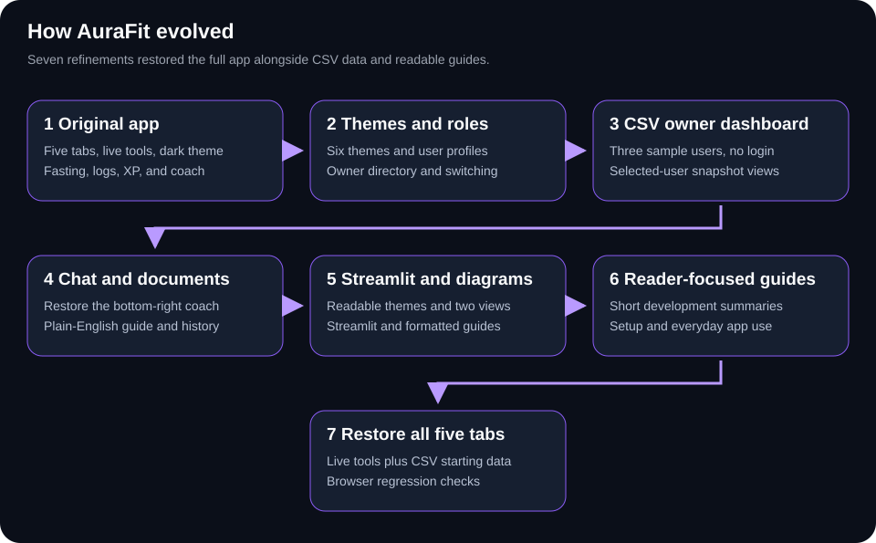

# AuraFit Project History

AuraFit developed from an interactive wellness app into a CSV-based dashboard
with owner and user views. The following steps summarize what was requested
and what changed, in plain English.

## 1. Build The Original App

### What was requested

Create a modern dark wellness app called AuraFit, with a distinctive logo,
five sections, a fasting timer, a daily journal, rewards, settings, and a
chat companion in the bottom-right corner.

### What changed

The first version included working dashboard, fasting, logger, rewards,
and profile screens. It saved progress in the browser, tracked real fasting
time, awarded progress points, and offered preset chat replies and motivation.
A Python entry point and a ready-to-open HTML preview were created.

## 2. Add Themes And Owner Controls

### What was requested

Offer several color themes and let an app owner see user statistics and
switch between the owner dashboard and individual user views.

### What changed

Six themes were added. The owner dashboard displayed local user profiles
and their statistics. Each profile had separate progress, and the owner
could open a selected person's view.

## 3. Use A CSV With Three Sample Users

### What was requested

Use a simple CSV file as the data source, provide three sample users, open
directly as the owner without login, and show only the selected user's data.

### What changed

A CSV was created for Alex Morgan, Jordan Lee, and Sam Rivera. The owner
dashboard began reading saved snapshots from that file. Import, reload,
and download controls were added. The HTML preview included a copy of the
sample data so it could also open without a server.

This version focused on reading saved statistics rather than starting
live fasts or changing user logs. Earlier interactive source files were kept.

## 4. Restore The Chat And Explain The Project

### What was requested

Bring back the missing bottom-right agent, record the app's development
history, and explain the project in language a beginner could understand.

### What changed

The chat companion returned to the owner dashboard. It could explain the
selected person's hydration, movement, and progress from their CSV snapshot.
The guide and development history were added as readable project files.

## 5. Improve Presentation And Add Streamlit

### What was requested

Make theme names readable, show the app in Streamlit, explain the two views,
and improve the documents with headings, subheadings, and diagrams.

### What changed

The theme menu received readable text and background colors. A view menu
offered separate owner and user snapshot screens. Streamlit was added to
display the app and its documents in a browser. The guide and history gained
formatted Markdown and HTML copies, plus explanatory diagrams.

## 6. Prepare The Documents For Repository Readers

### What was requested

Remove the GitHub upload instructions, replace the copied requests with
short development summaries, and make the guide focus on running and using
the app after downloading the repository.

### What changed

The upload instruction files and their sidebar links were removed. This
history now summarizes each request and result instead of reproducing
messages. The guide explains local setup, both views, the dashboard, CSV
controls, themes, and chat. Its commands are limited to running the app.

## 7. Restore All Five Working Tabs

### What was requested

Bring back the original tabs, preserve existing features when making
updates, test the combined app, and explain each tab in the documentation.

### What changed

The five original tab components were reconnected alongside the CSV owner
dashboard. Fasting timers, journals, reward claims, settings, export, and
reset work separately for each sample user. CSV starting data is combined
with saved browser progress. The guide and README explain each tab, and
browser regression checks exercise both views and the existing features.

## Current App

AuraFit now provides three sample profiles, five working tabs, owner and
user views, six themes, a rule-based chat companion, and a Streamlit display.
The CSV holds starting data; the browser saves each person's new progress.
No login or external AI service is required.

The project guide contains the setup and usage instructions for people
who download the repository.
